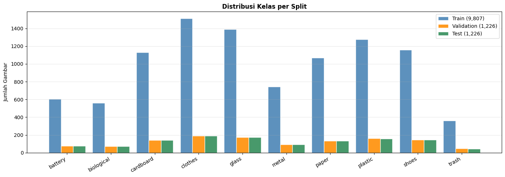
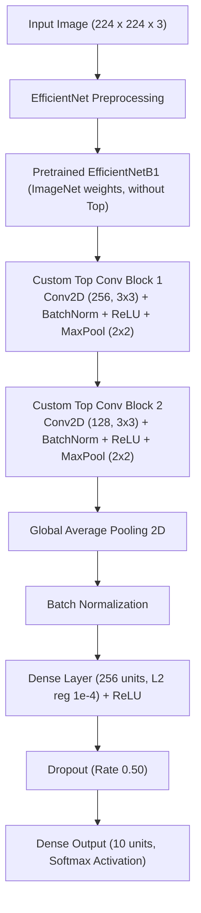
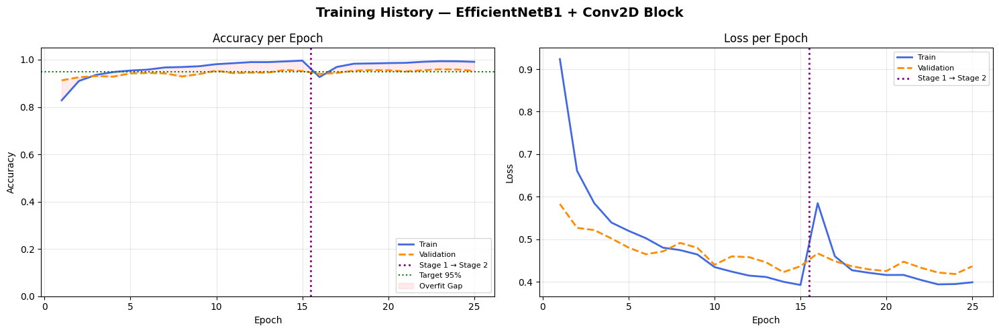
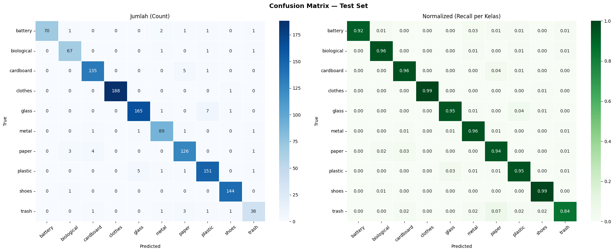
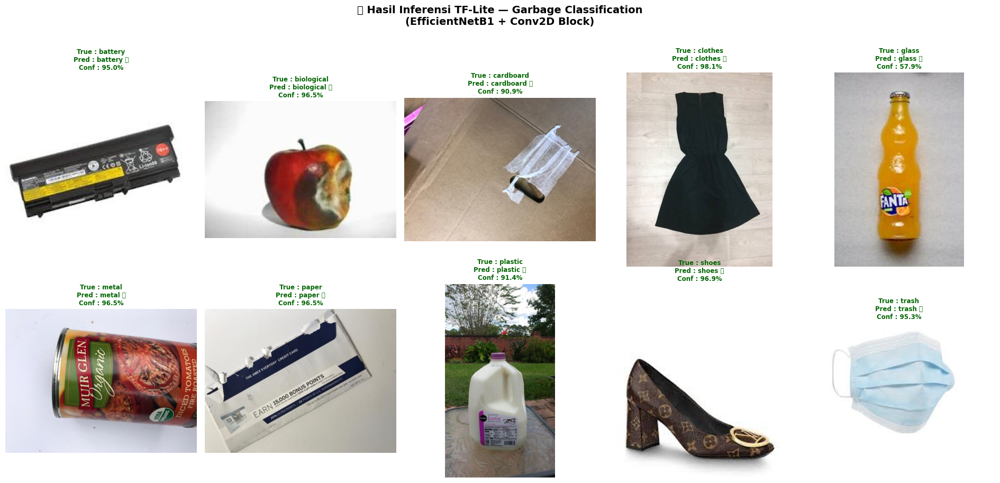

# ♻️ Garbage Image Classification — Deep Learning with EfficientNetB1

[](https://www.python.org/)
[](https://www.tensorflow.org/)
[](https://keras.io/)
[]()
[]()
[]()
[]()
[](https://github.com/JayJung666)
[](LICENSE)

Proyek ini merupakan implementasi model klasifikasi citra sampah (Garbage Image Classification) berbasis **Deep Learning** menggunakan **Convolutional Neural Network (CNN)** dengan strategi **Transfer Learning** pada arsitektur **EfficientNetB1** (pretrained ImageNet), custom Convolutional top blocks, dan pendekatan **Two-Stage Training** (Feature Extraction & Fine-Tuning).

Model ini mampu mengenali dan mengklasifikasikan **10 jenis sampah** secara akurat dengan capaian akurasi training sebesar **99.99%** dan akurasi test sebesar **95.68%** (melampaui target ambang batas kelulusan **≥ 95%**). Selain itu, model telah diekspor ke berbagai format deployment portabel: **SavedModel**, **TensorFlow Lite (.tflite)** untuk perangkat mobile/IoT, serta **TensorFlow.js (TFJS)** untuk inferensi berbasis web.

---

## 📌 Ringkasan Capaian Utama & Metrik Performa

| Dataset Split | Evaluated Loss | Evaluated Accuracy | Target Kriteria (≥ 95%) | Status |
| :--- | :---: | :---: | :---: | :---: |
| **Train Set** | `0.2990` | **99.99%** | ≥ 95.00% | ✅ **LULUS** |
| **Validation Set** | `0.4216` | **95.92%** | ≥ 95.00% | ✅ **LULUS** |
| **Test Set** | `0.4242` | **95.68%** | ≥ 95.00% | ✅ **LULUS** |

---

## 🗂️ Informasi Dataset & Pembagian Data

- **Nama Dataset**: [Garbage Classification V2](https://www.kaggle.com/datasets/sumn2u/garbage-classification-v2)
- **Total Citra**: 12.259 gambar (format RGB JPG/JPEG).
- **Jumlah Kelas**: 10 kelas sampah.
- **Rasio Pembagian**:
  - **Train Set**: `80%` (9.807 gambar original, kemudian diperluas menjadi 15.130 gambar dengan targeted augmentation untuk menangani class imbalance).
  - **Validation Set**: `10%` (1.226 gambar original murni tanpa augmentasi).
  - **Test Set**: `10%` (1.226 gambar original murni tanpa augmentasi).

### 🏷️ 10 Kelas Sampah yang Diklasifikasikan:

| Index | Label Kelas | Deskripsi Sampah |
| :---: | :--- | :--- |
| `0` | **battery** | Limbah baterai bekas / B3 elektronik portabel |
| `1` | **biological** | Sampah organik / sisa makanan & bahan biologis |
| `2` | **cardboard** | Kardus, karton pembungkus, boks karton |
| `3` | **clothes** | Pakaian bekas, kain, material tekstil |
| `4` | **glass** | Botol kaca, beling, toples kaca |
| `5` | **metal** | Kaleng minuman, aluminium, seng, material logam |
| `6` | **paper** | Kertas dokumen, koran, majalah bekas |
| `7` | **plastic** | Botol plastik, kantong plastik, wadah deterjen |
| `8` | **shoes** | Sepatu bekas, sandal, alas kaki |
| `9` | **trash** | Sampah residu / sampah umum tak terdaur ulang |

### 📊 Distribusi Data per Split:


---

## 🏗️ Arsitektur Model

Model dibangun menggunakan arsitektur modular yang menggabungkan kekuatan transfer learning dengan pemrosesan fitur adaptif:



### Detail Komponen:
1. **Base Model**: `EfficientNetB1` dengan bobot pretrained `imagenet`. Mampu menghasilkan representasi fitur hierarkis tingkat tinggi dengan efisiensi parameter yang optimal.
2. **Custom Top Conv Blocks**:
   - `Conv2D(256, (3,3))` $\rightarrow$ `BatchNormalization` $\rightarrow$ `ReLU` $\rightarrow$ `MaxPooling2D(2,2)`
   - `Conv2D(128, (3,3))` $\rightarrow$ `BatchNormalization` $\rightarrow$ `ReLU` $\rightarrow$ `MaxPooling2D(2,2)`
   - Bertujuan untuk memetakan dan memperhalus fitur spasial kompleks sebelum masuk ke lapisan klasifikasi.
3. **Regularisasi & Anti-Overfitting**:
   - **Label Smoothing**: Menggunakan `tf.keras.losses.CategoricalCrossentropy(label_smoothing=0.05)` untuk mencegah overconfidence pada distribusi probabilitas kelas.
   - **Kernel Regularizer**: $L_2$ regularization (`1e-4`) pada Dense layer.
   - **Dropout**: Probabilitas `0.50` sebelum layer output.
   - **Balanced Class Weights**: Dihitung dari frekuensi data asli untuk menjaga perlakuan adil antar kelas minoritas dan mayoritas.

---

## ⚙️ Strategi Pelatihan (Two-Stage Training)

Pelatihan dilakukan dalam dua tahap terpisah untuk menjaga stabilitas konvergensi bobot pretrained:

1. **Stage 1 — Feature Extraction (Head Training)**:
   - Base model `EfficientNetB1` di-*freeze* (`base_model.trainable = False`).
   - Hanya melatih Custom Conv Blocks dan Classifier Head.
   - **Optimizer**: Adam dengan Learning Rate `1e-3`.
   - **Epochs**: 15 epoch dengan callbacks: `ModelCheckpoint`, `EarlyStopping`, dan `ReduceLROnPlateau`.
   - **Hasil**: Best validation accuracy mencapai **94.29%**.

2. **Stage 2 — Fine-Tuning**:
   - Seluruh layer `EfficientNetB1` di-*unfreeze* (`base_model.trainable = True`).
   - Melatih seluruh jaringan secara end-to-end dengan learning rate lebih rendah (`1e-4`) agar bobot terlatih tidak rusak secara drastis (*catastrophic forgetting*).
   - **Epochs**: 10 epoch.
   - **Hasil**: Best validation accuracy meningkat hingga **95.92%**.

### 📈 Grafik Riwayat Pelatihan (Accuracy & Loss):


---

## 📊 Hasil Evaluasi & Confusion Matrix

### 📋 Classification Report (Test Set — 1.226 Citra):

```text
              precision    recall  f1-score   support

     battery       1.00      0.92      0.96        76
  biological       0.93      0.96      0.94        70
   cardboard       0.96      0.96      0.96       141
     clothes       1.00      0.99      1.00       189
       glass       0.96      0.95      0.96       174
       metal       0.94      0.96      0.95        93
       paper       0.92      0.94      0.93       134
     plastic       0.93      0.95      0.94       159
       shoes       0.98      0.99      0.99       145
       trash       0.88      0.84      0.86        45

    accuracy                           0.96      1226
   macro avg       0.95      0.95      0.95      1226
weighted avg       0.96      0.96      0.96      1226
```

### 🧩 Visualisasi Confusion Matrix:


---

## 🔍 Contoh Hasil Inferensi Menggunakan TensorFlow Lite

Model TF-Lite diuji melakukan prediksi langsung terhadap 10 sampel gambar acak dari data test (satu sampel per kelas). Seluruh 10 sampel berhasil diprediksi secara benar dengan tingkat keyakinan (confidence) yang sangat tinggi:



```text
══════════════════════════════════════════════════════════════
  True Label         Predicted          Confidence  Status
──────────────────────────────────────────────────────────────
  battery            battery                 95.0%    ✅
  biological         biological              96.5%    ✅
  cardboard          cardboard               90.9%    ✅
  clothes            clothes                 98.1%    ✅
  glass              glass                   57.9%    ✅
  metal              metal                   96.5%    ✅
  paper              paper                   96.5%    ✅
  plastic            plastic                 91.4%    ✅
  shoes              shoes                   96.9%    ✅
  trash              trash                   95.3%    ✅
══════════════════════════════════════════════════════════════
  Akurasi Inferensi Sampel: 10/10 (100%)
```

---

## 🚀 Format Deployment Model

Repositori ini menyediakan 3 format model siap pakai:

1. **TensorFlow SavedModel** (`saved_model/`):
   - Direktori standar berisi `saved_model.pb`, `assets/`, dan `variables/`.
   - Cocok untuk deployment menggunakan TensorFlow Serving, Docker, cloud container, atau backend API (FastAPI / Flask).
2. **TensorFlow Lite** (`tflite/model.tflite` & `tflite/label.txt`):
   - Ukuran model teroptimasi (~10.6 MB).
   - Dirancang khusus untuk inferensi offline berkecepatan tinggi pada perangkat mobile Android/iOS, Raspberry Pi, dan perangkat IoT edge.
3. **TensorFlow.js** (`tfjs_model/`):
   - Berisi `model.json` beserta shard binary weights.
   - Siap dimuat langsung pada browser web atau aplikasi Node.js tanpa membutuhkan server backend tambahan.

---

## 📁 Struktur Repositori

```text
garbage-image-classification/
├── assets/                               # Visualisasi dan grafik evaluasi
│   ├── dataset_split.png
│   ├── training_history.png
│   ├── confusion_matrix.png
│   └── inference_results.png
├── saved_model/                          # Model dalam format TensorFlow SavedModel
│   ├── assets/
│   ├── fingerprint.pb
│   ├── saved_model.pb
│   └── variables/
├── tfjs_model/                           # Model dalam format TensorFlow.js
│   ├── group1-shard1of10.bin .. shard10of10.bin
│   └── model.json
├── tflite/                               # Model dalam format TensorFlow Lite
│   ├── label.txt                         # Daftar label urutan kelas
│   └── model.tflite                      # File binary model TFLite
├── .gitignore                            # Konfigurasi pengecualian Git
├── notebookgarbageclassification.ipynb   # Notebook lengkap (Data Prep, Modeling, Eval, Export)
├── README.md                             # Dokumentasi komprehensif proyek
└── requirements.txt                      # Daftar dependensi library Python
```

---

## 💻 Panduan Instalasi & Penggunaan

### 1. Kloning Repositori
```bash
git clone https://github.com/JayJung666/garbage-image-classification.git
cd garbage-image-classification
```

### 2. Buat Lingkungan Virtual & Pasang Dependensi
```bash
# Membuat virtual environment
python -m venv venv

# Aktivasi virtual environment (Windows)
.\venv\Scripts\activate

# Aktivasi virtual environment (Linux/macOS)
# source venv/bin/activate

# Install dependensi
pip install -r requirements.txt
```

### 3. Contoh Inferensi Gambar Baru dengan TF-Lite (Python)
```python
import numpy as np
import tensorflow as tf
from PIL import Image
from tensorflow.keras.applications.efficientnet import preprocess_input

# 1. Load label kelas
with open("tflite/label.txt", "r") as f:
    class_names = [line.strip() for line in f.readlines()]

# 2. Inisialisasi TFLite Interpreter
interpreter = tf.lite.Interpreter(model_path="tflite/model.tflite")
interpreter.allocate_tensors()

input_details = interpreter.get_input_details()
output_details = interpreter.get_output_details()

def predict_garbage(image_path):
    # Load dan sesuaikan ukuran gambar
    img = Image.open(image_path).convert("RGB").resize((224, 224))
    img_array = preprocess_input(np.array(img, dtype=np.float32))
    img_array = np.expand_dims(img_array, axis=0)

    # Inferensi
    interpreter.set_tensor(input_details[0]["index"], img_array)
    interpreter.invoke()
    predictions = interpreter.get_tensor(output_details[0]["index"])[0]

    top_idx = int(np.argmax(predictions))
    predicted_class = class_names[top_idx]
    confidence = float(predictions[top_idx])

    return predicted_class, confidence

# Contoh pemanggilan
# label, score = predict_garbage("path_ke_gambar.jpg")
# print(f"Hasil Klasifikasi: {label} ({score*100:.2f}%)")
```

---

## 👨‍💻 Identitas Author & Pengembang

- **Nama**: Antonius Vincent Jung
- **GitHub**: [@JayJung666](https://github.com/JayJung666)
- **Email**: cacc012d6y2282@student.devacademy.id
- **ID Dicoding**: CACC012D6Y2282
- **Tujuan**: Proyek Submission Akhir Pembelajaran Machine Learning & Computer Vision

---

## 📄 Lisensi
Proyek ini dilisensikan di bawah lisensi [MIT License](LICENSE).
